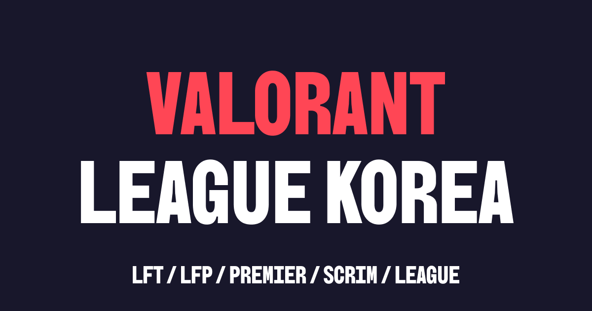

  

  <b>한국 e스포츠 아마추어 씬의 성장을 목표로 하는 플랫폼</b> 
  프로게이머를 꿈꾸는 선수와 대회를 준비하는 사람들에게 정보와 편의를 제공합니다. 
  발로란트를 시작으로 더 많은 종목으로 넓혀 갑니다.

  <a href="https://valorant.leaguekorea.xyz">VALORANT LEAGUE KOREA</a> ·
  <a href="https://leaguekorea.xyz">LEAGUE KOREA</a> ·
  <a href="https://discord.gg/valorantkorea">Discord</a>

---

### 무엇을 하나요

| | |
|---|---|
| **커뮤니티** | LFT(팀 찾기) · LFP(팀원 모집) · 프리미어 · 스크림 — 디스코드 로그인 하나로 |
| **대회 · 내전** | 싱글 · 더블 · 트리플 엘리미네이션 대진표, 실시간 점수, 누구나 여는 소규모 내전 |
| **TEAM** | 우리 팀을 알리는 팀 페이지 — 연혁, 하이라이트, 팀원 소개, 공유 카드 |
| **PLAYER** | 선수 프로필 · 선수 찾기 · 주 요원 · 장비, 팀 · 선수 팔로우 |
| **디스코드 봇** | 사이트 소식을 서버로 — 모집 글 피드, `/프로필` · `/팀` 카드 |

### 함께 만들기

개발 참여는 초대로 진행합니다. 함께하고 싶다면 [디스코드](https://discord.gg/valorantkorea)로 연락해 주세요.

VALORANT는 Riot Games, Inc.의 상표입니다. LEAGUE KOREA는 Riot Games가 보증하거나 후원하지 않습니다.
